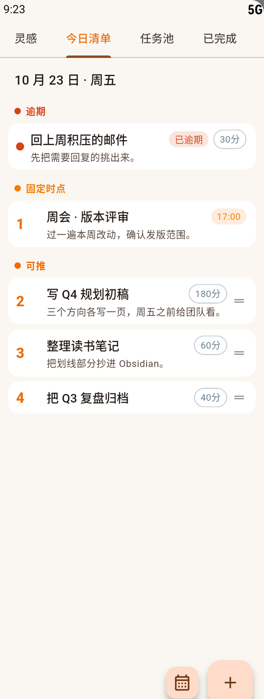

# 动态任务调度 Todo

以 Markdown 存数据、按「时间裕度」决定先做什么的本地任务提醒应用。
Windows 上是一个四页横滑的面板，安卓上是一枚随时拖出来的悬浮把手；没有账号、没有服务器，
任务数据就是一个 Obsidian 能直接打开的文件夹，两台设备在同一 Wi-Fi 里双向同步。

Windows 10/11 · Android · MIT

<p align="center">
  
  
  
</p>

## 它和普通待办的区别

待办 App 默认按截止时间排序，分不出这种差别：两件事都 12 月交，一件要 30 小时、一件要
30 分钟，现在该动哪件？截止时间排不出来，**裕度**能——还能用的工时减去还要花的工时。
裕度薄的排在前面，裕度宽的往后放。

裕度到 0 了也不进"很急"那一档：它单独成一档等你裁决，改截止、砍范围，或者加班。

## 特性

- **提醒跟着压力走**：裕度宽时隔几天提一次，裕度薄了间隔自动缩短。默认档不跑这套算法，
  只在截止前和截止那一刻各提一次。
- **两档调度**：无排序（默认，算法只挑今天该看的几件，组内先后全交给你拖）、标准（按裕度
  排先后，提醒跟着压力走）。切档不改数据，只改"算法替你做多少主"。
- **两条时间轴**：今日清单是算法排出来的顺序；『今日编排』是你自己写的「几点做什么」，
  能提前排明天。编排只管排，不占工时、不进调度、不响提醒。
- **长期任务**：估不出工时的事标成『长期』，不参与裕度计算；要动手时『挂起进行』，顶在
  今日页最上面，完成或取消前一直在。
- **周期性任务**：每天、或每周指定星期几，按规则生成当天实例；每个实例都是普通任务，
  可以单独改期。
- **主线**：一件正在推进的大事 = 一串行为链 + 日历上圈日期写下的记录。行为链的步骤不是
  任务，不占工时。
- **数据在你自己手里**：`tasks.md` 你写、`.gtd/<任务id>.md` 应用写；在 Obsidian 里改名、
  改日期、加删行都会生效，删掉的东西进 `.gtd/.trash/` 捞得回来。
- **局域网同步**：一台当主机、其余当从机（通常 Windows 做主机），同一网络内双向同步；
  冲突由主机裁决，被覆盖的版本存档到 `.gtd/conflicts/`，不丢数据。首次开主机会弹防火墙
  对话框，要允许专用网络入站；路由器禁了广播就手输 IP。
- **随手记**：安卓把把手拖到屏幕中间松手，弹出一条输入框，不用打开应用；长按把手可以换边。
  拖出面板才展开四页，不占地。

## 装上

**安卓**：到 [Releases](https://github.com/lumen-one/gtd_todo/releases) 下 `arm64-v8a` 那个 APK
（近几年的手机都适用；老的 32 位机用 `armeabi-v7a`），装在手机上时允许「安装未知来源应用」。

**从源码跑**（Windows / 安卓）：需要 Flutter（Dart 3）。

```bash
git clone https://github.com/lumen-one/gtd_todo.git
cd gtd_todo
flutter pub get
flutter run -d windows     # 或 -d android
dart run tool/seed_tasks.dart   # 想先看点样例数据就跑这句
```

打包成不依赖开发环境的独立程序：

```bash
flutter build windows --release
```

产物是 `build/windows/x64/runner/Release/` 整个文件夹，拷到 Win10/11 双击就能跑。
任务数据不在那个文件夹里——默认落项目下的 `tasks/`，换位置设环境变量 `GTD_TASKS_DIR`，
或在设置页 → 文件访问里选。

## 你的数据长什么样

```markdown
# 工作

- [ ] 写周报 创建 2026-10-23,09:00 结束 2026-10-24,18:00 上周复盘 ##工作
- [x] 交房租 创建 2026-10-01,09:00 完成 2026-10-01,09:30 ##生活
```

人写的那半边在 `tasks.md`：任务名、创建 / 结束 / 完成日期、备注、标签。应用只改自己那
一行（打勾、补完成时刻），其余一字不动，也永不重排行。

应用算的那半边在 `.gtd/<任务id>.md`：工时、优先级、裕度、剩余量，一个任务一份。两边靠
行指纹配对，所以你怎么改 `tasks.md` 都不会把算出来的进度弄丢。

文件格式细节见 [formats](docs/formats/README.md)。

## 文档

- 每个页面怎么用：[docs/panels/](docs/panels/README.md)——今日清单、任务池、灵感、已完成、
  日历、主线、编排、把手、桌面壳
- 交互全貌与提醒规则：[docs/ui-interaction.md](docs/ui-interaction.md)
- 调度算法与分层结构：[docs/architecture.md](docs/architecture.md)
- 数据格式与同步：[docs/formats/](docs/formats/README.md)、[docs/sockets/sync.md](docs/sockets/sync.md)
- 每个取舍当时否掉了什么：[docs/decisions/](docs/decisions/README.md)

想改代码、或者让 agent 接手：见 [AGENTS.md](AGENTS.md)。

## 协议

MIT，见 [LICENSE](LICENSE)。
